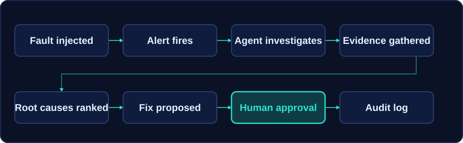

[README (1).md](https://github.com/user-attachments/files/33601703/README.1.md)[Upl<p align="center">
  
</p>

<p align="center">
  <a href="https://www.linkedin.com/in/afwaan-sarfaraz/"></a>
  <a href="mailto:afwaansarfaraz7@gmail.com"></a>
</p>

Final-year B.Tech CSE student who builds LLM systems as backends first and prompts second: queues, typed tools, retrieval, evaluation, and a human in the loop. Open to AI engineering internships and roles.

```text
$ whoami
afwaan / B.Tech CSE, final year

$ focus
agents, retrieval, evals, observability

$ now
building Sherlog (incident agent)
```


## Featured projects

### [Sherlog](https://github.com/afwaansarfaraz/SHERLOG): AI incident investigation agent

An on-call assistant that investigates production alerts, ranks likely root causes with evidence, and proposes a fix that a human approves or rejects. It runs against a demo SaaS (API, orders, payments, database) where faults are injected on purpose, so every diagnosis has a known right answer.



- **Ingestion:** a FastAPI endpoint stores each alert in PostgreSQL and publishes it to Redis Streams. A worker consumes it with consumer groups, retries, and a dead-letter queue.
- **Agent:** investigation state machine with typed, read-only tools (Prometheus, Loki, Jaeger, git), an execution budget, and PostgreSQL-backed checkpoints.
- **Grounding:** runbook retrieval via embeddings and vector similarity. Telemetry is filtered for prompt-injection patterns before it reaches the model.
- **Control:** remediation proposals require approve or reject, and each decision lands in an audit log.
- **Evaluation:** 6 injectable fault types, 10 benchmark scenarios, and a deterministic rule-based baseline. The pipeline falls back to that baseline if the LLM is unavailable. 144 backend tests.
- **Engineering decision:** the baseline came first. The agent is measured against it, with ground-truth files treated as immutable, so the LLM has to earn its added complexity.

`Python` `FastAPI` `Redis Streams` `PostgreSQL` `SQLAlchemy` `Alembic` `Groq` `Prometheus` `Loki` `Jaeger` `OpenTelemetry` `Docker` `React` `TypeScript` `pytest`

<details>
<summary>Investigation workspace screenshot</summary>
<br>

</details>

Status: in active development. No hosted demo.

### [Voice Coach AI](https://github.com/afwaansarfaraz/voice-coach-ai): real-time spoken English coach

Speak into the browser and get coaching replies back as audio. Audio streams over a FastAPI WebSocket to Deepgram for transcription, a Groq-hosted Llama model writes the reply, and Edge-TTS speaks it.

- Filler-word analysis for English and Hinglish, plus librosa-based audio analysis.
- A post-transcription correction layer for code-mixed Hindi and English speech.
- **Engineering decision:** requests go to a fast 8B model first and fall back to a 70B model on failure, with latency logged per call.

`Python` `FastAPI` `WebSockets` `Deepgram` `Groq` `Edge-TTS` `librosa`

Status: in development. Not deployed.

### [TOFA](https://github.com/afwaansarfaraz/TOFA): restaurant operating system

A multi-outlet POS, kitchen display, and inventory platform for Indian restaurants.

- GST-compliant billing (CGST and SGST split) with idempotency keys against double submission.
- Kitchen display with station routing, and recipe-based inventory deduction.
- QR table ordering that re-derives prices from the menu on the server, not from the client.
- Offline-first sync queue. Tenant and outlet isolation with Postgres row-level security on Supabase.
- A ⌘K assistant: an LLM (xAI Grok) calls deterministic tools to answer questions about sales, stock, and dishes, including in Hinglish.
- **Engineering decision:** every number comes from a deterministic calculation tool. The model only chooses tools and phrases the answer.

`React 19` `Vite` `Tailwind` `Supabase` `PostgreSQL` `JavaScript`

### [SMS Spam Detection](https://github.com/afwaansarfaraz/sms-spam-detection)

Three classifiers compared on 5,572 labelled SMS messages: embeddings with a dense head, a Bi-LSTM, and transfer learning from the Universal Sentence Encoder. The transfer-learning model scored best at 98.39% accuracy and 0.938 F1 (figures from the repo README).

`Python` `TensorFlow` `Keras` `TensorFlow Hub` `scikit-learn`

Also: [Retail Sales Dashboard](https://github.com/afwaansarfaraz/Retail-Sales-Dashboard) (Power BI, DAX) and [Dolphin Collections](https://github.com/afwaansarfaraz/dolphin-collections) (React, TypeScript, GSAP storefront).


## Toolkit

<table>
  <tr>
    <td width="22%"><b>AI and ML</b></td>
    <td></td>
  </tr>
  <tr>
    <td><b>LLM engineering</b></td>
    <td>Tool calling (Groq, xAI Grok), retrieval with embeddings and vector similarity, agent state machines, evaluation harnesses, prompt-injection filtering, speech-to-text with Deepgram</td>
  </tr>
  <tr>
    <td><b>Backend</b></td>
    <td><br>WebSockets, SQLAlchemy, Alembic, pytest</td>
  </tr>
  <tr>
    <td><b>Frontend</b></td>
    <td></td>
  </tr>
  <tr>
    <td><b>Infra and observability</b></td>
    <td><br>Loki, Jaeger, OpenTelemetry</td>
  </tr>
</table>

## Background

- **Codnexa**, intern (Nov 2025 to Apr 2026): data cleaning with an LLM wrapper, and production full-stack work including the L G Irrigation website.
- **Torpedo Web**, co-founder: a web agency for the hospitality sector ([torpedoweb.org](https://torpedoweb.org)).
- **Integral University, Lucknow:** B.Tech in Computer Science and Engineering, final year.

## GitHub activity

<p align="center">
  
  
</p>

<sub>Language mix reflects bytes of code in public repos, not skill.</sub>


## Contact

- LinkedIn: [linkedin.com/in/afwaan-sarfaraz](https://www.linkedin.com/in/afwaan-sarfaraz/)
- Email: [afwaansarfaraz7@gmail.com](mailto:afwaansarfaraz7@gmail.com)
oading README (1).md…]()
